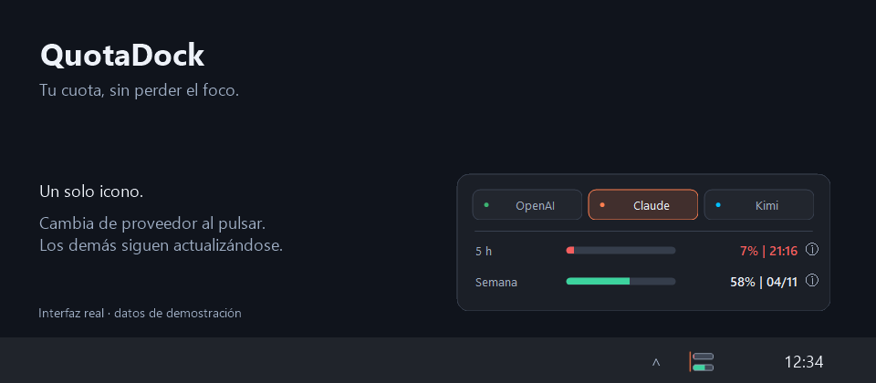
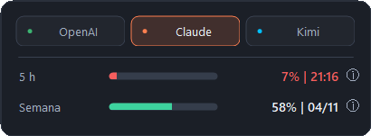

# QuotaDock

**Tus límites de IA, de un vistazo.**

**Un icono. Dos barras. El proveedor que tú elijas.**

Tus cuotas de IA junto al reloj, sin llenar la bandeja de iconos. Pulsa para cambiar de proveedor; los demás siguen actualizándose en segundo plano.

**Windows 10/11 · MIT · Portable o instalable · Sin administrador**

Rama de desarrollo: **1.3.0**, con consulta de restablecimientos. La última versión publicada está en **Releases**; las funcionalidades nuevas de `main` no se deben atribuir a una release anterior.

<p align="center">
  
</p>

> Vista previa de la interfaz real, compuesta con datos de demostración. No contiene cuentas ni cuotas personales.

## Un solo icono, todos tus proveedores

<p align="center">
  
</p>

1. **Pulsa el icono** para abrir las dos barras y las pestañas.
2. **Elige un proveedor:** cambian el color del icono y sus dos porcentajes, sin otra consulta.
3. **Cierra el panel:** la bandeja conserva únicamente las barras del proveedor elegido. La selección se recuerda al volver a abrir QuotaDock.

También puedes cambiar desde **clic derecho → Proveedor visible**. Las flechas izquierda y derecha recorren las pestañas. Los proveedores con errores muestran `—%`, sin sustituirse por otro silenciosamente.

## Novedades

- **Un solo icono:** activa varios proveedores, elige cuál ver y cambia desde las pestañas del panel.
- **Inicio con Windows:** configurable desde el menú, también en modo portable.
- **Actualización fiable:** espera por proveedor, `Retry-After` en 429/503 y reintentos progresivos. «Actualizar» no se salta la espera.
- **Identificación:** banda de color por proveedor y nombre en el tooltip y el menú.
- **Diseño moderno y ligero:** panel redondeado, pestañas con estados de foco y hover, tipografía Segoe UI, barras suaves y menú oscuro. Dibujo nativo con GDI+, sin navegador integrado, librerías externas ni bucles de animación. Respeta el alto contraste de Windows.
- **Avisos opcionales:** umbral de 5%, 10%, 20% o 25%, desactivados por defecto; no repiten el aviso mientras la cuota siga baja.
- **Restablecimientos:** junto al porcentaje, solo la hora en la ventana de 5 horas (`26% | 21:16 ⓘ`) o el día/mes en la semanal (`80% | 04/11 ⓘ`). El icono `ⓘ` muestra el detalle al pasar el ratón.
- **Más proveedores:** OpenCode Go, Kimi, MiniMax, Z.AI/Zhipu, Copilot y Gemini CLI, además de Codex y Claude.

## Descargar

En **[Releases](https://github.com/warante/quotadock/releases/latest)** encontrarás la última versión publicada. Al compilar `main`, los artefactos de desarrollo se generan en `dist\v1.3.0`:

| Artefacto | Uso |
| --- | --- |
| `QuotaDock-<versión>-Setup.exe` | Instalar para tu usuario con inicio automático opcional. |
| `QuotaDock-<versión>-Windows-Portable.zip` | Descomprimir y abrir `QuotaDock.exe`. |
| `QuotaDock.exe` | Ejecutable portable individual, sin dependencias externas. |
| `SHA256SUMS.txt` | Huellas SHA-256 del instalador, ZIP y aplicación. |

Los binarios publicados **siguen sin firma** hasta disponer de una firma de código válida. Preparar el proyecto para SignPath no significa que esté admitido ni que sus releases estén firmadas. En un equipo administrado, solicita aprobación si Windows bloquea la ejecución.

El instalador usa `%LOCALAPPDATA%\QuotaDock`, crea un acceso en Inicio y registra la desinstalación por usuario. **Abrir QuotaDock al finalizar** está activado por defecto. Si Windows impide abrirlo, se informa de que está instalado pero bloqueado: eso no se confunde con un fallo de instalación. No descarga paquetes, no instala servicios y no necesita administrador. Si falla la instalación, intenta restaurar sus archivos y configuración anteriores. Cierra QuotaDock antes de actualizar.

## Primer uso

1. Abre `QuotaDock.exe`. En una instalación nueva de 1.3.0 no se activa ningún proveedor hasta que tú lo elijas; una actualización conserva los que ya habías activado.
2. Clic derecho → **Proveedores** para activar los que utilices. Todos comparten un único icono. Si desactivas todos, ese mismo icono abre el menú para reactivarlos.
3. Configura la sesión o clave de cada proveedor como se indica abajo.
4. Si el icono está oculto en **^**, arrástralo junto al reloj.

Un clic abre las pestañas y las dos líneas con sus barras, etiquetas y porcentajes **restantes** del proveedor seleccionado. Los colores verde/amarillo/rojo indican más del 25%, hasta el 25% y hasta el 10%. Gris y `—%` significan dato no disponible, no cuota agotada. La franja de color y el tooltip identifican al proveedor visible.

## Proveedores

| Proveedor | Cómo conectar | Barras |
| --- | --- | --- |
| OpenAI / Codex | `codex login` con ChatGPT; lee la sesión local | 5 h / semana de Codex |
| Claude | Claude Code → `/login`; lee la sesión local | 5 h / semana global |
| OpenCode Go / Go Plus | **Configurar credencial**, `OPENCODE_GO_API_KEY` o `OPENCODE_API_KEY` | 5 h / semana; mes seleccionable |
| Kimi Code global / China | Clave de Kimi Code; `KIMI_API_KEY` / `KIMI_CN_API_KEY` | 5 h / semana o mes según la respuesta |
| MiniMax global / China | Subscription Key; `MINIMAX_API_KEY` / `MINIMAX_CN_API_KEY` | Intervalo / semana del pool de texto |
| Z.AI / Zhipu | Clave del Coding Plan; `ZAI_API_KEY` / `ZHIPU_API_KEY` | 5 h / semana o mes según el proveedor |
| GitHub Copilot | Token OAuth; `GITHUB_COPILOT_TOKEN` o `gh auth token` del CLI oficial | Premium/mes / Chat/mes |
| Gemini CLI | Sesión Google de Gemini CLI; opcional `GEMINI_ACCESS_TOKEN` | Pro / Flash, no 5 h / semana |

Los conectores nuevos se han probado con datos sintéticos: **no se garantiza acceso con todos los tipos de cuenta** y varios endpoints son internos/experimentales. Consulta [PROVIDERS.md](PROVIDERS.md) para fuentes, regiones, límites y proveedores estudiados pero todavía no compatibles (DeepSeek, Qwen/Alibaba, MiMo, Cursor, Grok y otros).

La región se selecciona explícitamente: **nunca se prueba tu clave en otra región ni en otro proveedor**. Una clave de API de pago por uso no equivale a una clave de suscripción.

### Sesiones oficiales

- Codex: `%CODEX_HOME%\auth.json`, o `%USERPROFILE%\.codex\auth.json`, con alternativa `.config\codex\auth.json`.
- Claude: `%CLAUDE_CONFIG_DIR%\.credentials.json`, o `%USERPROFILE%\.claude\.credentials.json`.
- Gemini CLI: `%USERPROFILE%\.gemini\oauth_creds.json`; se consulta el proyecto con Google si no defines `GOOGLE_CLOUD_PROJECT`.
- Copilot: solo al activarlo y si no has proporcionado credencial, se invoca `auth token --hostname github.com` del GitHub CLI instalado en la ubicación oficial de Program Files. No se consulta tu navegador ni se imprime el token. El OAuth de GitHub CLI puede carecer de permisos de Copilot.

Las sesiones se releen en cada consulta, sin renovar ni modificar sus tokens. Si caducan, inicia sesión en el cliente oficial. No se leen el Administrador de credenciales ni la base de datos de OpenCode V2. Para Go utiliza la clave de tu suscripción, guardada aquí de forma cifrada o mediante variable de entorno.

### Claves manuales

**Configurar credencial** permite guardar una clave o token para los proveedores que lo admiten. Se cifra con **Windows DPAPI, para el usuario actual**, en `%APPDATA%\QuotaDock\credentials`. No es portable entre cuentas ni máquinas. La entrada está enmascarada, no se vuelve a mostrar el secreto y no se copia al proyecto ni al ZIP. Elige **Olvidar clave** para eliminarlo. Las variables de entorno tienen prioridad.

Los ajustes no secretos se guardan en `%APPDATA%\QuotaDock\settings.json`, y la próxima consulta permitida en `cooldowns.json`, para no perder la espera al reiniciar. No se guarda el historial de uso ni la respuesta completa del proveedor.

## Frecuencia, errores y avisos

- Codex se consulta cada **60 segundos**; el resto cada **5 minutos**, para reducir bloqueos de los endpoints de cuotas.
- No es streaming. Los datos pueden tener además retraso en el proveedor.
- 401: sesión o clave rechazada. 403: permisos, región, plan o bloqueo; no se asume siempre que el token haya caducado.
- 429/503: respeta `Retry-After` y aplica espera progresiva; el clic manual, desactivar/reactivar un proveedor y reiniciar no eliminan esa espera si se puede guardar y recuperar `cooldowns.json`.
- Los errores limpian las barras: no se muestran datos antiguos como actuales. El menú contiene el estado de conexión, sin respuestas privadas del servidor.
- Los avisos están apagados por defecto. Se envía uno al cruzar el umbral por ejecución; se rearma después de recuperar más de dos puntos porcentuales sobre él. Windows puede silenciarlos con No molestar.
- La opción **Priorizar mes en la segunda barra** muestra el cupo mensual cuando exista; no cambia una cuota mensual por una semanal ficticia. No se indican reinicios calculados localmente.

### Hora de restablecimiento

Junto al porcentaje de **5 horas** se muestra únicamente la **hora de reinicio**, por ejemplo `26% | 21:16 ⓘ`. En la **semanal**, únicamente **día/mes**, por ejemplo `80% | 04/11 ⓘ`. Se usa hora peninsular española con cambio automático CET/CEST, sin añadir texto bajo las barras. Solo al pasar el ratón sobre `ⓘ` aparece el tooltip con fecha, hora y zona completas. Si falta el dato o ha vencido se muestra `—`, y el tooltip explica la situación. Para otras ventanas se muestra el día/mes disponible; `≈` identifica una hora aproximada.

El menú **clic derecho → Restablecimientos · hora peninsular** conserva el detalle completo. La información se actualiza al consultar el proveedor; no hay un temporizador de cuenta atrás.

- Los timestamps absolutos se convierten a `Europe/Madrid`, incluidos los cambios CET/CEST y la hora repetida de octubre.
- Si solo hay segundos restantes, se anclan a la recepción de la respuesta y se etiquetan como **aproximados**.
- Una fecha sin hora, como las que puede devolver Copilot, se mantiene como fecha comunicada, sin asumir medianoche ni una zona horaria.
- Los reinicios pasados se muestran como `—`; su detalle indica que están pendientes de actualizar. Datos ausentes, unidades inválidas o varios reinicios incompatibles dentro de una familia no generan una hora ficticia.

Consulta la matriz de campos y fuentes en [PROVIDERS.md](PROVIDERS.md). El servidor puede modificar sus límites; una hora comunicada no es una garantía de disponibilidad futura.

## Inicio automático y migración

Activa **Iniciar con Windows** desde el menú o el instalador. Se usa únicamente `HKCU\…\Run\QuotaDock`. En modo portable apunta a la ruta actual: si mueves el ejecutable, desactiva y reactiva la opción desde su nueva ubicación.

Las versiones nuevas conservan tus proveedores activados, claves cifradas y esperas. La primera vez eligen el primer proveedor activado; después recuerdan el que selecciones. Cierra la versión anterior antes de instalar para sustituir el ejecutable. No necesitas repetir el inicio de sesión salvo que haya caducado.

No se modifican ni borran los ejecutables independientes de 1.0.0 ni sus accesos de inicio. Si aún los usas, cierra sus iconos y retira sus accesos de `shell:startup` para evitar duplicar consultas.

## Desinstalar

**Configuración → Aplicaciones → QuotaDock**, o el acceso **Desinstalar QuotaDock** de Inicio. Solo se detiene el ejecutable instalado y se eliminan sus archivos conocidos, accesos y registro propios. No se borran archivos ajenos ni sesiones de clientes oficiales. Los ajustes y claves cifradas se conservan; utiliza **Olvidar clave** antes de desinstalar si quieres retirarlas.

En modo portable, desactiva primero el inicio automático, sal y borra el ejecutable.

## Seguridad y privacidad

- Solo HTTPS a destinos fijos. No se siguen redirecciones con credenciales.
- No hay telemetría, servidor propio, cookies de navegador, inferencia ni consumo de tokens para consultar cuotas.
- Tokens solo en memoria durante la consulta; las claves manuales solo se persisten cifradas para el usuario de Windows.
- Respuestas limitadas a 1 MiB y consultas con timeout. No se muestran respuestas crudas ni mensajes privados del proveedor.
- Las pruebas y los artefactos no incluyen cuentas reales. El commit usa identidad `noreply`.
- Las APIs internas pueden cambiar. QuotaDock no está afiliado a los proveedores ni garantiza disponibilidad de sus endpoints.

## Compilar, verificar y firmar

Requisitos: Windows 10/11 y .NET Framework 4.x; sin Python, Node, NuGet ni SDK moderno de .NET.

```powershell
.\build.ps1          # dist\v1.3.0\QuotaDock.exe
.\test.ps1           # pruebas sintéticas, HTTP simulado, DPAPI e instalación aislada
.\release.ps1        # aplicación, instalador, ZIP y SHA-256
.\package-test.ps1   # recursos del instalador y desinstalación en sandbox
.\privacy-check.ps1  # fuentes y artefactos, sin imprimir coincidencias sensibles
.\audit-history.ps1  # historial completo, refs y reflogs, sin imprimir secretos
.\verify.ps1         # todas las comprobaciones anteriores
```

Firma opcional con un certificado **de confianza** de firma de código en `Cert:\CurrentUser\My`, con clave privada. Configura `QUOTADOCK_SIGNING_THUMBPRINT` y ejecuta:

```powershell
.\release.ps1 -RequireSigned
```

Se firma primero la aplicación, después se incrusta en el instalador, se firma el instalador y se generan los hashes. Sin certificado, `-RequireSigned` falla: no se publica una firma falsa. La adquisición y custodia del certificado quedan a cargo del propietario del proyecto.

`.github/workflows/windows.yml` ejecuta las pruebas, compilación, auditorías y comprobación del kit de integración en GitHub Actions. No utiliza credenciales de proveedores. `ci/signpath.yml` sigue siendo una plantilla sin activar: prepara una firma en dos etapas únicamente tras la admisión y configuración de SignPath. Como alternativa local, `.githooks/pre-push` ejecuta la verificación antes de una subida cuando configuras `git config core.hooksPath .githooks`.

Si la política de tu equipo bloquea scripts o ejecutables sin firmar, utiliza mecanismos aprobados por tu administrador; no desactives el control de aplicaciones.

## Historial

[CHANGELOG.md](CHANGELOG.md) · [Fuentes y estado de proveedores](PROVIDERS.md)

## Próximos pasos

[Estado de las tareas](TODO.md): restablecimientos, apertura del proyecto, solicitud de firma gratuita y recursos de integración.

## Open source

Licencia [MIT](LICENSE). Consulta [cómo contribuir](CONTRIBUTING.md), el [código de conducta](CODE_OF_CONDUCT.md), las [notificaciones de seguridad](SECURITY.md) y los [avisos de terceros](THIRD_PARTY_NOTICES.md).

## Code signing policy

Consulta la [Code signing policy](docs/code-signing-policy.md), los roles de firma y la [política de privacidad](PRIVACY.md). La solicitud gratuita a SignPath está en preparación; **no hay una admisión ni un certificado concedidos**. [SIGNPATH.md](SIGNPATH.md) describe los requisitos que todavía dependen del propietario y del servicio.

## Piconera Tech

El [kit de integración](integrations/piconera-tech/README.md) incluye icono SVG/PNG, banners ES/EN, imagen social, textos, ficha HTML y traducciones para el porfolio de Piconera Tech. No modifica ni despliega esa web.
